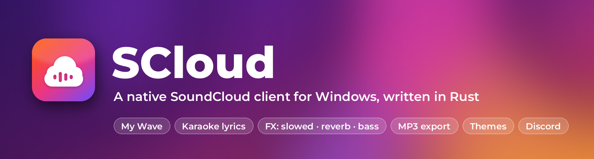
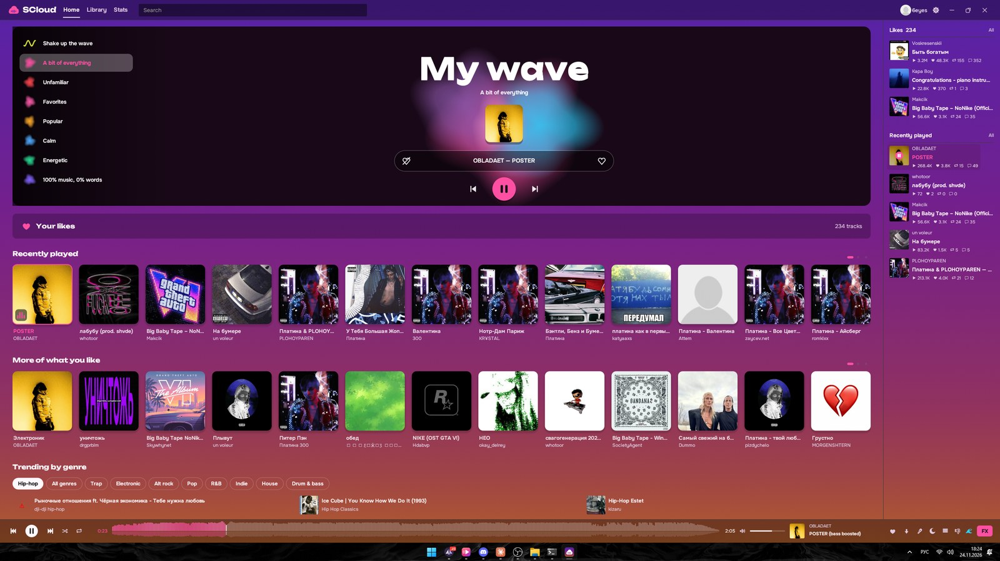
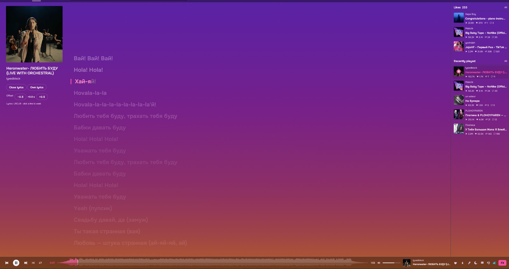

<p align="center">
  
</p>

<p align="center">
  <a href="https://github.com/X1ND1/SCloud/releases/latest"></a>
  
  
  
</p>

SCloud is a fast, native desktop client for SoundCloud. It doesn't wrap the website in a browser: the UI is drawn with egui and audio plays through libmpv, so it starts instantly and stays light. On top of search and playback it adds things the website doesn't have: a personal **My Wave** feed, karaoke lyrics, audio effects like slowed + reverb, MP3 export, themes and Discord Rich Presence.

> [!NOTE]
> SCloud is an unofficial, personal-use project. It is not affiliated with or endorsed by SoundCloud.

## Screenshots

<p align="center">
  
</p>
<p align="center">
  
</p>

## Features

### Listening
- **Search** with live suggestions and recent queries, the same results as soundcloud.com.
- **Player** with SoundCloud's real waveform as the seek bar, queue, shuffle/repeat and a sleep timer (15–90 min or "end of track").
- **Media keys** ⏯ ⏭ ⏮ and the Windows media overlay with artwork (volume flyout and lock screen).
- **Right-click any track** to play next, add to the queue, start a track radio, like, add to a playlist, download or copy the link.
- Go+ tracks play as 30-second previews (full Go+ streams are DRM-protected).

### My Wave
- An endless recommendation feed built from your likes and history, including artists from features (`A & B`, `feat.`, `prod. by`).
- Modes: **A bit of everything**, **Unfamiliar**, **Favorites**, **Popular**, **Calm**, **Energetic**, **100% music, 0% words**, plus one-click waves for your most played artists.
- It learns as you go: skipping early means less of that, listening through means more, and 👎 removes a track for good.
- Recommendations stay varied: one track per artist per batch, and artists that just played are pushed back.

### Lyrics
- **Synced karaoke lyrics** from LRCLIB: the current line fills with color as it's sung, and clicking a line seeks to it.
- Falls back to **Genius** and checks the match by title, artists (Cyrillic ↔ Latin aware) and even artwork similarity.
- No timestamps? Lines are spread over the track automatically. Fix the timing with the ±0.5 s offset or by **right-clicking the line that's playing now**. The offset is saved per track.
- **Your own lyrics**: paste plain text or LRC, or sync it yourself by pressing Space at the start of each line.
- Optional local AI alignment with whisper.cpp (one-click install, runs offline).

### Relax mode (F10)
Full screen over the taskbar: the artwork, title, a live waveform, controls and centered karaoke lyrics. The background is made of color blobs that react to the loudness of the track. Press **F11** for plain full screen anywhere in the app.

### Effects (FX)
Presets: Slowed + Reverb, Slowed + Bass, Nightcore, Sped Up, Bass Boost, 8D, Vaporwave, Lo-fi, Underwater, Concert Hall, Phone, Karaoke. There are also sliders for speed, pitch, reverb, bass and treble, a **10-band equalizer** and loudness normalization. Effects are ffmpeg filters inside mpv and are baked into MP3 downloads.

### Library
- **Likes and history** sync with your SoundCloud account. Sign in through an embedded window, Google sign-in included.
- **Playlists**: create, rename and fill them from the right-click menu, or import your SoundCloud playlists.
- **Stats**: listening hours for the year, month, week and today, your streak, charts and top artists/tracks.
- **MP3 downloads** with artwork and tags to a folder you choose.
- Everything is also backed up to `Documents\SCloud`, so it survives a reinstall.

### Look & feel
- Themes: Dark, Midnight, GTA VI, Ocean, and a **custom gradient editor** like Discord's, with draggable color keys, angle, accent and window transparency.
- **Share themes as codes** such as `1B4ZK-9SDKF-8123K-…`, and import them back.
- The window and taskbar icon are recolored to match your theme, and the taskbar icon animates while music plays.
- Spring animations, smooth page transitions and a frameless window.
- **Discord Rich Presence**: "Listening to …" with the track, artist and active effects.
- Interface languages: English, Russian and Ukrainian, picked automatically from your system.

## Install

### Just want to use it?
You **don't need Rust, Git or anything else**. Download **`SCloud-Setup-x.y.z.exe`** from [Releases](https://github.com/X1ND1/SCloud/releases/latest) and run it.

- No administrator rights are needed: it installs into your user profile and adds Start menu and desktop shortcuts.
- Requires Windows 10/11 x64. Sign-in uses Edge WebView2, which is already part of Windows.
- MP3 export (ffmpeg) is an optional component in the installer.
- Uninstall it like any other app in *Settings → Apps*. Your likes, history and settings stay in `Documents\SCloud`.

> [!TIP]
> If Windows SmartScreen says "Windows protected your PC", click **More info → Run anyway**. The installer isn't code-signed because this is a hobby project.

## Hotkeys

| Key | Action |
| --- | --- |
| `Space` | Play / pause |
| `←` / `→` | Seek 5 s (30 s with `Shift`) |
| `↑` / `↓` | Volume |
| `N` / `P` | Next / previous track |
| `L` | Like |
| `M` | Mute |
| `Ctrl+F` | Search |
| `F10` | Relax mode |
| `F11` | Full screen |
| `F1` | Hotkey help |
| `Esc` | Close pop-ups / leave relax mode |

## Discord Rich Presence

1. Create an application at <https://discord.com/developers/applications>. Its name is what appears after "Listening to", for example `SoundCloud`.
2. Copy the **Application ID** from *General Information*.
3. In SCloud open ⚙ → Discord and paste the ID. In Discord, make sure *Activity Privacy → Share your detected activities* is on.

## Build from source

Only needed if you want to change the code. On a clean PC it takes about 15–30 minutes, mostly downloads.

### 1. Install the tools (once)

| Tool | Why | How to get it |
| --- | --- | --- |
| **Git** | to download the code | <https://git-scm.com/download/win>, or `winget install --id Git.Git -e` |
| **Rust** | the compiler | <https://rustup.rs>: download `rustup-init.exe`, run it and press **Enter** to accept the defaults |
| **Visual Studio C++ Build Tools** | the linker Rust needs on Windows | `setup.bat` installs them for you. Manual install: <https://visualstudio.microsoft.com/visual-cpp-build-tools/> and tick **"Desktop development with C++"** |

`winget` ships with Windows 10/11. If you install Rust from the link, `rustup-init.exe` may also offer to install the Build Tools; let it.

After installing, **close and reopen** any terminal so it picks up the new tools. Check them with:
```bat
git --version
cargo --version
```

### 2. Get the code and build

```bat
git clone https://github.com/X1ND1/SCloud.git
cd SCloud
setup.bat
```
No Git? Click **Code → Download ZIP** on GitHub, unpack it and double-click `setup.bat`.

`setup.bat` does everything else by itself:
- checks Rust and the C++ Build Tools (installs the Build Tools via winget if missing);
- downloads **libmpv** (playback), **ffmpeg** (MP3 export) and the **fonts** once into `%LOCALAPPDATA%\SCloud`;
- builds the app and puts `scloud.exe` with its DLLs into the `app\` folder, then launches it.

Run it with a normal **double-click, not "Run as administrator"**. The first build takes a few minutes. After that, rebuilds take seconds and nothing is downloaded again, even if you unpack a new version into another folder.

### 3. Optional

- **Installer:** `build-installer.bat` produces `dist\SCloud-Setup-<version>.exe` and installs Inno Setup if needed.
- **Release on GitHub:** push a tag like `v0.2.0` and the GitHub Actions workflow builds the installer and attaches it to the release.

<details>
<summary>Troubleshooting</summary>

- **`Rust not found`**: reopen the terminal after installing Rust, or run `setup.bat` from Explorer instead of an admin terminal.
- **`link.exe not found` / Build Tools errors**: install the Build Tools manually (link above) with "Desktop development with C++".
- **The build fails with `0xc0000409`**: run `setup.bat` again. It already gives the compiler a bigger stack and retries once.
- **The app closes right after start**: a dialog shows the error, and the full log is in `%LOCALAPPDATA%\SCloud\crash.log`. Please attach it to an issue.
</details>

<details>
<summary>Linux (experimental)</summary>

```sh
sudo apt install libmpv-dev ffmpeg
cargo run --release
```
Sign-in, likes sync, media keys and the animated taskbar icon are Windows-only.
</details>

## Project structure

```
src/
  main.rs        window setup, crash reporter, helper processes
  app.rs         the whole UI: pages, player, My Wave, relax mode, settings
  api.rs         SoundCloud api-v2 client (client_id, search, streams, likes, playlists)
  wave.rs        recommendation engine
  lyrics.rs      LRCLIB + Genius lookup, matching, own lyrics, offsets
  align.rs       optional whisper.cpp lyric alignment
  player.rs      libmpv wrapper
  fx.rs          audio effects → ffmpeg/lavfi filter chains
  theme.rs       palettes, gradient editor model, theme codes
  login.rs       WebView2 sign-in window and the hidden "bridge" browser
  library.rs     likes, history, playlists, backups
  stats.rs       listening statistics
  downloader.rs  MP3 export with ffmpeg
  discord.rs     Discord IPC Rich Presence
  media.rs       Windows system media controls (SMTC)
  logo.rs        logo, theme-colored and animated window icon
  i18n.rs        English / Russian / Ukrainian strings
```

## How it works

- **API.** SCloud talks to `api-v2.soundcloud.com`, the same API the website uses. A `client_id` is extracted from the site's JS bundle, cached, and refreshed automatically on 401/403.
- **Playback.** Since late 2025 SoundCloud serves HLS AAC, so SCloud picks the best DRM-free transcoding and hands it to libmpv.
- **Writes (likes, history).** These are protected by DataDome, so they're sent from a hidden WebView2 page on soundcloud.com using your signed-in session. The bridge process closes itself after 45 s of inactivity.
- **Privacy.** Your account token stays on your machine (`%APPDATA%\scloud`). There is no server: stats are computed locally from your SoundCloud history.

## Disclaimer

SCloud uses SoundCloud's unofficial API. This may violate SoundCloud's Terms of Use, so use it for personal listening only. Respect artists' rights when downloading. Full Go+ tracks are DRM-protected and are not played.

## License

[MIT](LICENSE)
